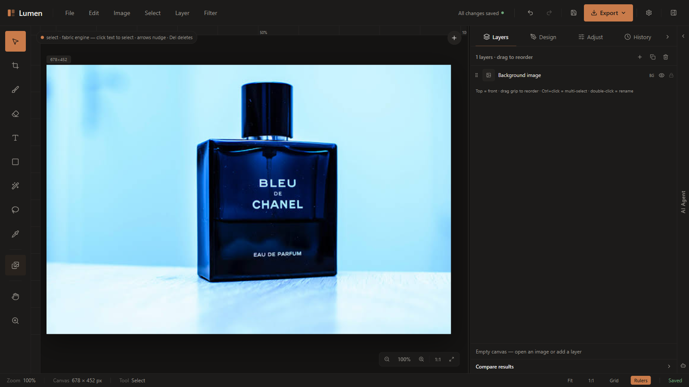

# Lumen

A browser-based raster photo editor with a Python vision backend. Layers, masks, typography, brush painting, non-destructive adjustments, and neural background removal — running either fully client-side or against a local FastAPI service.



[](https://github.com/muhamedaldias/luen/actions/workflows/ci.yml)
[](LICENSE)

## Why this exists

Most web editors pick one side of a trade-off. Fully client-side editors stay responsive but fall over on heavy vision work — seamless cloning, inpainting, and multi-band blending are painful to write in JavaScript and easy to write in OpenCV. Cloud editors handle the math but add a round-trip to every slider drag.

Lumen runs both, and picks per operation. The switch is a single value: if the operation needs the backend and an image has been uploaded, it goes to `/api/operations/*`; otherwise it runs locally on Canvas 2D. Drag a brightness slider offline and it responds immediately; run a Poisson blend with the backend up and you get the real `cv2.seamlessClone`. There is no mode toggle to manage and no "backend required" wall.

The practical consequence is that **the editor works with no backend at all**. Background removal runs locally through ONNX Runtime Web against a bundled 4.4 MB `u2netp` model, so there is no API key, no upload, and no image ever leaves the browser. The Python service is an optional accuracy upgrade, not a prerequisite.

The one thing that does reach the network is typography: `src/index.css` imports 38 Google Fonts, so text layers fall back to local defaults until that request completes (or indefinitely, offline). See Known limitations.

## Requirements

| | Version | Notes |
|---|---|---|
| Node.js | `^20.19.0` or `>=22.12.0` | Vite 8 requires this. **Node 18 will not work.** |
| pnpm | `10.x` | Pinned to `10.34.3` in `.mise.toml`. It is the only supported package manager — `pnpm-lock.yaml` is the only lockfile. |
| Python | `3.10+` | Optional — only for the vision backend |
| Rust / Cargo | stable | Optional — only for the desktop shell |

## Running the web app

```bash
git clone https://github.com/muhamedaldias/luen.git
cd luen
pnpm install
pnpm dev
```

The dev server binds port **8443** (`strictPort` is on, so a busy port fails loudly rather than silently moving). Open `http://localhost:8443`.

```bash
pnpm build      # production bundle into dist/
pnpm preview    # serve the built bundle
pnpm typecheck  # tsc --noEmit
pnpm test       # node-based unit tests, no browser needed
pnpm verify     # typecheck + test + build
```

`pnpm build` produces a ~20.4 MB `dist/`. Only ~1.3 MB of that is application code. The rest is the ONNX Runtime WASM binary (10.5 MB), the bundled segmentation model (4.4 MB), and the Arabic user-guide PDF that ships with the app (4.2 MB). The main bundle is ~862 KB (~251 KB gzipped).

## Running the backend

```bash
cd backend
python -m venv .venv
source .venv/bin/activate        # Windows: .venv\Scripts\activate
pip install -r requirements.txt
uvicorn app.main:app --host 127.0.0.1 --port 8000 --reload
```

Swagger UI is at `http://localhost:8000/docs`. The Vite dev server already proxies `/api` to `127.0.0.1:8000`, so no frontend config change is needed.

`rembg` and `onnxruntime` are deliberately kept out of `requirements.txt` — they pull in several hundred MB of runtime and model weights, and are only used by the server-side background-removal path. Install them separately when you want that:

```bash
cd backend
pip install -r requirements-ai.txt
```

There is one source of truth for Python dependencies: `backend/requirements.txt`. The root `requirements.txt` only forwards to it.

## Architecture

```
                    ┌──────────────────────────────┐
                    │   React 19 + Fabric.js 6     │
                    │   layers, masks, text, tools │
                    └───────────────┬──────────────┘
                                    │
              canvasImage.imageId == null ?
                                    │
                ┌───────────────────┴───────────────────┐
                │ yes                               no  │
                ▼                                       ▼
      ┌─────────────────────┐              ┌────────────────────────┐
      │  localOps.ts        │              │  FastAPI + OpenCV      │
      │  Canvas 2D / LUTs   │              │  ProcessPoolExecutor(4)│
      │  ONNX Runtime Web   │              │  Pillow / NumPy / rembg│
      │  u2netp.onnx        │              │  /api/operations/*     │
      └─────────────────────┘              └────────────────────────┘
              offline                                online
```

**Frontend.** React 19 with Vite 8 and TypeScript in `strict` mode. Canvas work is Fabric.js 6. State is plain React — five layer arrays plus a `layerOrder` list of references, with fractional 0–1 geometry that survives canvas resizing. There is no Redux, Zustand, or Context: the editor state lives in `src/App.tsx`, which is honest about being the weak point of the codebase (see Known limitations).

**Backend.** FastAPI with SQLAlchemy and Alembic, dispatching work through a `ProcessPoolExecutor` so CPU-bound operations actually use multiple cores instead of fighting the GIL. 36 operations are registered behind a single `POST /api/operations/{name}` endpoint; 11 routes in total cover images, uploads, jobs, and saved projects.

**Desktop.** Tauri v2 wrapping the same frontend, with a PyInstaller-built sidecar for the backend. Scaffolded but not finished — see Desktop status.

## Features

**Layers.** Image, text, shape (rect/ellipse), solid fill, and brush-stroke layers in one stack. 16 blend modes, per-layer alpha masks (non-destructive, invertible, bakeable), and magnetic snapping to document bounds and sibling edges.

**Typography.** Custom fonts, gradients, per-corner rounding, padding, line height, letter spacing, borders, alignment, and drop shadows. Text layers stay editable rather than being rasterized on commit.

**Color and tone.** Brightness, contrast, exposure in EV stops (`brightness(2^stops)`, ±2 EV), saturation, temperature, highlights, shadows, whites and blacks as white/black-point LUT curves, sharpness, and blur. Levels and curves have a real sampled histogram drawn from the current image — switchable across RGB, R, G, B.

**Image blending.** Five distinct modes — `seamless_normal`, `seamless_mixed`, `seamless_mono`, `pyramid`, and `feather`. All five run client-side. With the backend up, the three `seamless_*` modes map to genuine `cv2.seamlessClone` (`NORMAL_CLONE` / `MIXED_CLONE` / `MONOCHROME_TRANSFER`) and `pyramid` maps to a 5-level Laplacian blend; `feather` is a soft alpha lerp on both paths, so it does not improve. The local implementations are mean-color matching, high-frequency detail reinjection, and multi-scale feathered masks — related techniques, but not the same algorithms, and the UI labels say so.

**Background removal.** `u2netp.onnx` via ONNX Runtime Web (WASM), fully offline. Click-anchored subject targeting, then mask refinement: 8-connectivity connected-component pruning to drop stray islands, softness detection with adaptive erosion to keep hair and glass edges without colored halos, and alpha feathering.

**Selections.** Magic wand (flood fill) and quick-select (brush-painted seeds), plus mask editing with brush and eraser. There is no rectangular marquee or lasso tool — selections come from color and from painted seeds.

**Export.** PNG (32-bit alpha), JPEG (with matte color), and WebP, at 60–100% quality, via a Canvas 2D compositor that avoids SVG `<foreignObject>` and the tainted-canvas exceptions that come with it.

**Projects.** Save and load `.lumen` project files; autosave to `localStorage` with restore-on-reload.

**Themes.** 11 palettes (Ember, Arctic, Sage, Obsidian, Pearl, Cinematic, Warm, Cold, Noir, Faded, Vivid), persisted to `localStorage`.

### Keyboard shortcuts

| Key | Action | | Key | Action |
|---|---|---|---|---|
| `V` | Select | | `H` | Pan |
| `C` | Crop | | `Z` | Zoom |
| `B` | Brush | | `[` `]` | Brush / eraser size |
| `E` | Eraser | | `Ctrl+Z` | Undo |
| `T` | Text | | `Ctrl+Y` / `Ctrl+Shift+Z` | Redo |
| `U` | Shape | | `Ctrl+S` | Save `.lumen` project |
| `W` | Smart select | | `Ctrl+L` | Levels |
| `K` | Magic wand | | `Ctrl+M` | Curves |
| `Q` | Quick select | | `Ctrl+Shift+M` | Mask from selection |
| `I` | Eyedropper | | `G` / `R` | Grid / rulers |
| `L` | Asset library | | | |

Color balance has no shortcut — use the Adjust tab. `Ctrl+Shift+M` derives a layer mask from the current selection, or adds a white mask when there is none.

## API

All operations share one registry and one endpoint. Everything starts by uploading an image, which returns the `image_id` every other call needs:

```bash
# 1. upload — returns image_id
curl -s -F file=@photo.jpg http://127.0.0.1:8000/api/images/upload
# {"image_id":"a3f1…","url":"/api/storage/local/a3f1…/original.png","width":1920,
#  "height":1080,"size_bytes":284913,"mime":"image/jpeg"}

# 2. run an operation
curl -s -X POST http://127.0.0.1:8000/api/operations/adjust \
  -H 'Content-Type: application/json' \
  -d '{"image_id":"a3f1…","params":{"exposure":25,"contrast":10}}'
# {"status":"done","result_url":"/api/storage/local/a3f1…/adjusted.png"}   # fast

curl -s -X POST http://127.0.0.1:8000/api/operations/blend \
  -H 'Content-Type: application/json' \
  -d '{"image_id":"a3f1…","params":{"foreground_id":"b7c2…","mode":"seamless_normal"}}'
# {"status":"processing","job_id":"9e01…"}                                # slow

# 3. poll a job
curl -s http://127.0.0.1:8000/api/operations/9e01…/status
# {"status":"done","result_url":"/api/storage/local/a3f1…/blended.png","error":null}
```

Serve the returned `result_url` as-is — it is already absolute from the API root, and the Vite dev proxy forwards `/api` so the same path works from the frontend.

Which operations return a job rather than a result is decided by `get_slow_operations()` — see the Mode column below.

```http
POST /api/operations/{operation_name}
Content-Type: application/json

{ "image_id": "hex_image_id", "params": { } }
```

| Operation | Notes | Engine | Mode |
|---|---|---|---|
| `crop` `resize` `rotate` `flip` `affine` `resize_canvas` | Spatial transforms, Lanczos resampling | Pillow / OpenCV | sync |
| `adjust` `brightness_contrast` `hue_saturation` `color_balance` `vibrance` | Tonal and color correction, LAB space | OpenCV | sync |
| `levels` `curves` `threshold` `posterize` `invert` `solarize` | Color levels, cubic-spline curves | NumPy | sync |
| `blur` `sharpen` `motion_blur` `grain` `vignette` `pixelate` `glitch` | Convolution and stylization | OpenCV / Pillow | sync |
| `grayscale` `sepia` `filter` `style` | Artistic and stylistic filters | Pillow / NumPy | sync |
| `auto_enhance` | CLAHE local contrast | OpenCV | job |
| `pro_enhance` | Multi-stage enhancement pipeline | OpenCV | job |
| `blend` | Poisson cloning and Laplacian multi-band blending | OpenCV | job |
| `remove_object` | Navier–Stokes and Telea inpainting with mask dilation | OpenCV | job |
| `upscale` | 2× / 4× Lanczos4 with a pixel cap | OpenCV | job |
| `denoise` `radial_blur` | Non-local means denoising, zoom-blur synthesis | OpenCV | job |
| `remove_background` | Tries `isnet-general-use`, else `u2net`, else GrabCut | rembg / OpenCV | job* |

\* `remove_background` is a job only when `rembg` is importable; without it the operation runs synchronously through the process pool. The split for every operation comes from `get_slow_operations()` in `backend/app/config.py`. The model name is what is attempted first — `background.py` silently falls back to `u2net` and then to OpenCV GrabCut, so the returned quality depends on which path ran.

Full schemas are in the Swagger UI, which is generated from the code and therefore always current.

### Configuration

Backend settings come from environment variables or `backend/.env` (see `backend/.env.example`). The defaults:

| Variable | Default | Purpose |
|---|---|---|
| `HOST` / `PORT` | `0.0.0.0` / `8000` | Bind address and port |
| `DATABASE_URL` | `sqlite:///./lumen.db` | SQLAlchemy URL for projects and image metadata |
| `STORAGE_ROOT` | `storage` | Where originals, results, and masks are written |
| `MAX_FILE_SIZE_MB` | `15` | Upload ceiling |
| `MAX_DIMENSION` | `8000` | Longest side allowed after resize |
| `MAX_IMAGE_PIXELS` | `64000000` | Total pixel ceiling (decompression-bomb guard) |
| `POOL_WORKERS` | `4` | `ProcessPoolExecutor` worker count |
| `PREVIEW_MAX_SIDE` | `4096` | Downscale target for interactive previews |
| `JOB_TTL_SECONDS` | `600` | How long a finished job stays pollable |
| `CORS_ORIGINS` | localhost:5173, :8443 | Allowed browser origins |
| `CORS_ORIGIN_REGEX` | any `localhost` / `127.0.0.1` port | Additional origin pattern |
| `DEFAULT_USER_ID` | `local` | Storage namespace; there are no accounts |
| `DEBUG` | `false` | Enables debug mode and `/docs` verbosity |

## Testing

```bash
pnpm test        # mask refinement, blend planning, histogram, menu wiring
pnpm typecheck   # strict TypeScript
cd backend && python -m pytest -q    # 22 tests
```

CI runs all three on every push and pull request to `main`, plus two guards worth keeping: the built bundle is checked for any leftover `cdn.jsdelivr.net` reference (the ONNX runtime and model must stay local so the app works offline), and the repository is scanned for image or model files under 200 bytes, which is what an unfetched Git LFS pointer looks like.

The frontend tests are plain Node scripts rather than a browser runner. That keeps `pnpm test` fast and dependency-free, but it also means **there are no DOM or browser integration tests**. Anything that only breaks in a real browser — canvas compositing, Fabric event handling, focus behavior — is currently caught by hand, not by CI. This is the largest testing gap in the project.

## Desktop status

The Tauri shell is configured but **does not yet produce a working installer**. Three things are missing:

| Item | State | Needed |
|---|---|---|
| `src-tauri/src/main.rs` | Incomplete | Does not spawn the backend sidecar |
| `src-tauri/capabilities/default.json` | Incomplete | Grants only `core:default`; needs `shell:allow-execute` / `allow-spawn` |
| `src-tauri/binaries/` | Absent | Must contain a built `lumen-backend-<target-triple>` executable |

Everything else is in place — `tauri.conf.json` sets the identifier (`com.lumen.editor`), CSP, `externalBin`, and `frontendDist`, and the icons are real binaries. To finish it:

```bash
pyinstaller backend/lumen.spec --noconfirm
# copy the output to src-tauri/binaries/lumen-backend-x86_64-pc-windows-msvc.exe
pnpm tauri build
```

Windows builds are not code-signed, so SmartScreen will warn on first run.

## Known limitations

These are current, not a backlog.

- **The backend has no authentication and no rate limiting**, and its default host in `config.py` is `0.0.0.0` (all interfaces). The command above passes `--host 127.0.0.1` to keep it local — keep that flag unless you intend to expose it, and do not expose port 8000 without putting something in front of it.
- **`routes_images.py` returns `Access-Control-Allow-Origin: *`** for image delivery. Fine for local development, wrong for a public deployment.
- **`src/App.tsx` is ~2,900 lines** with 56 `useState`, 30 `useRef`, and 26 `useEffect` hooks. It works, and the extraction targets are clear (`src/lib/` already holds 18 focused modules), but it is the main refactor target and the hardest file to review.
- **Undo stores full document snapshots.** Depth adapts to image size (25 / 15 / 10 steps for small / medium / large documents) to bound memory. Past that depth, history is lossy.
- **No browser integration tests** — see Testing.
- **38 Google Fonts load from one render-blocking `@import`** in `src/index.css`. They are genuinely used by the text tool, so the fix is self-hosting or `font-display` with a preload, not removal.
- **The desktop shell is unfinished** — see Desktop status.

## Troubleshooting

**`EBUSY: resource busy or locked` from Vite's file watcher on Windows.** Usually a temp-file swap from an editor saving over a watched file. Stop the dev server, save the file, restart.

**`ERR_PNPM_IGNORED_BUILDS`.** `pnpm-workspace.yaml` controls which dependencies may run install scripts. `protobufjs` is allowed (onnxruntime-web needs it); `canvas` is explicitly denied because it is an unused optional dependency of Fabric that requires cairo/pango and fails to build on most Linux systems.

**Nothing loads at `http://localhost:8443`.** `strictPort` is enabled, so if the port was already taken the server failed instead of quietly moving. Check for a stale process on 8443.

**Background removal is slow on first use.** ONNX Runtime compiles its WASM kernels on first inference. Subsequent runs are much faster.

## Documentation

- **[Lumen-User-Guide-AR.pdf](Lumen-User-Guide-AR.pdf)** — illustrated Arabic user guide, also served at `/Lumen-User-Guide-AR.pdf` by the web app.
- **[Lumen-User-Guide-AR.html](Lumen-User-Guide-AR.html)** — same guide in HTML.
- **[guide-assets/](guide-assets/)** — the screenshots used in the guide and above.
- **[docs/PROJECT-SPEC.md](docs/PROJECT-SPEC.md)** — the full architectural specification.
- **[docs/](docs/)** — design notes and the Figma-scaffold migration analysis.

## Credits

- **[U-2-Net](https://github.com/xuebinqin/U-2-Net)** by Xuebin Qin — the `u2netp` segmentation model.
- **[rembg](https://github.com/danielgatis/rembg)** by Daniel Gatis — server-side background removal.
- **[Fabric.js](https://github.com/fabricjs/fabric.js)**, **[ONNX Runtime Web](https://github.com/microsoft/onnxruntime)**, **[OpenCV](https://opencv.org/)**, and **[Tailwind CSS](https://tailwindcss.com/)**.

The project began as a Figma Make scaffold; roughly 85% of `vite.config.ts` is still Figma's development infrastructure. `docs/figma-vs-lumen-from-scratch.md` records what that means for anyone maintaining the build config.

## Contributing

Issues and pull requests are welcome. Two things to know before you start:

- `pnpm verify` runs typecheck, tests, and a production build — CI runs exactly this, so run it locally first.
- `src/lib/*.ts` modules are the preferred place for logic; `src/App.tsx` is already too large and new state there makes review harder, not easier.

There is no code of conduct or contributor guide yet, and no CLA. Commit messages follow `type: summary` (the existing history uses `feat:`, `fix:`, and `docs:`).

## License

MIT — see [LICENSE](LICENSE).

## Language

Everything in this repository — code, comments, commit messages, and docs — is written in English.

The one exception is a localized end-user deliverable: [`Lumen-User-Guide-AR.pdf`](Lumen-User-Guide-AR.pdf), an illustrated Arabic walkthrough of the editor. It is a product asset for Arabic-speaking users, not development documentation, and it is also served by the running app at `/Lumen-User-Guide-AR.pdf`.

